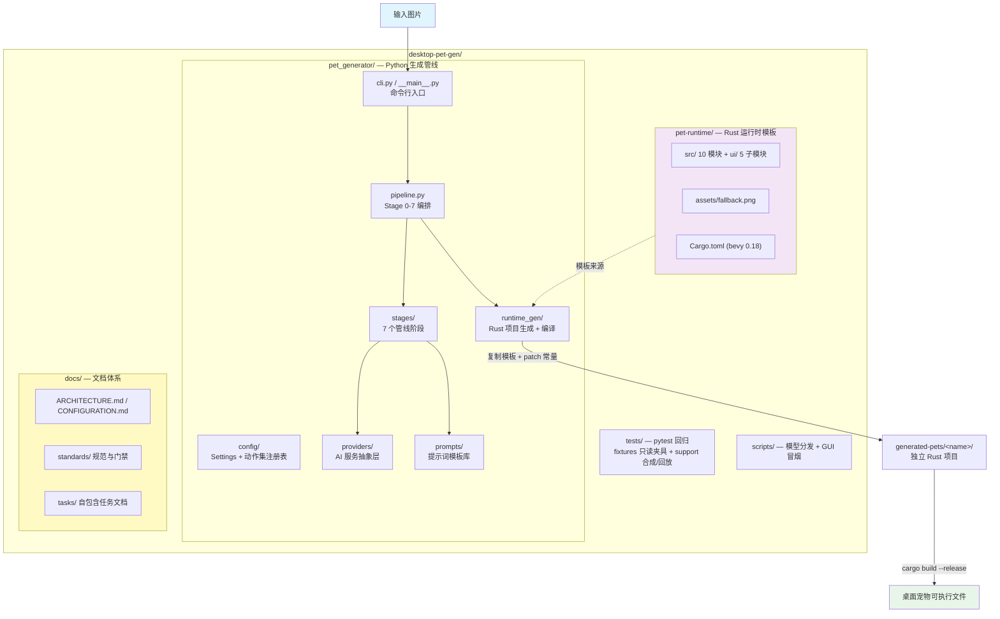
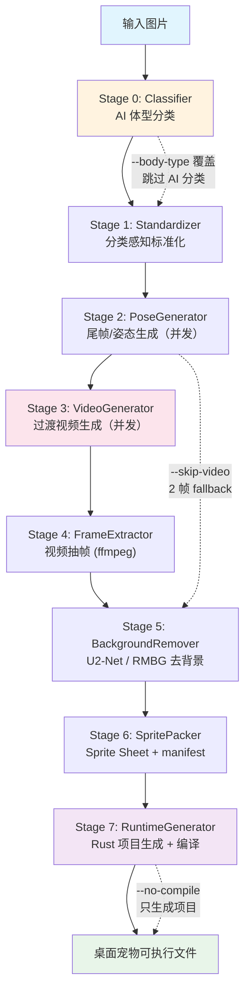
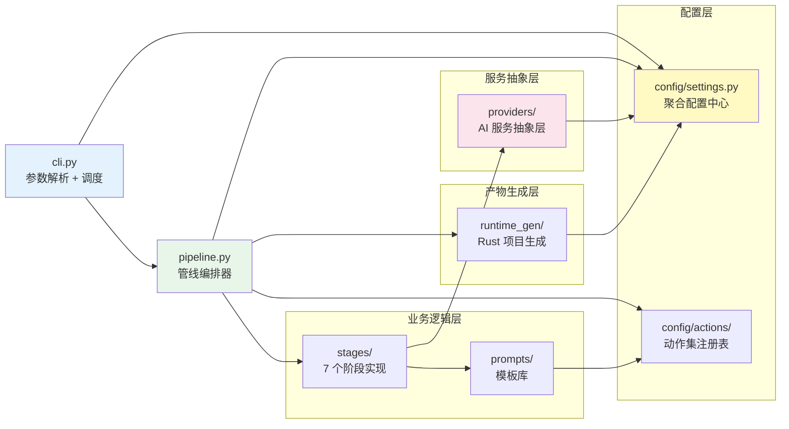
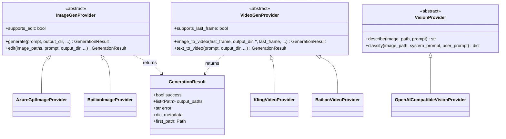
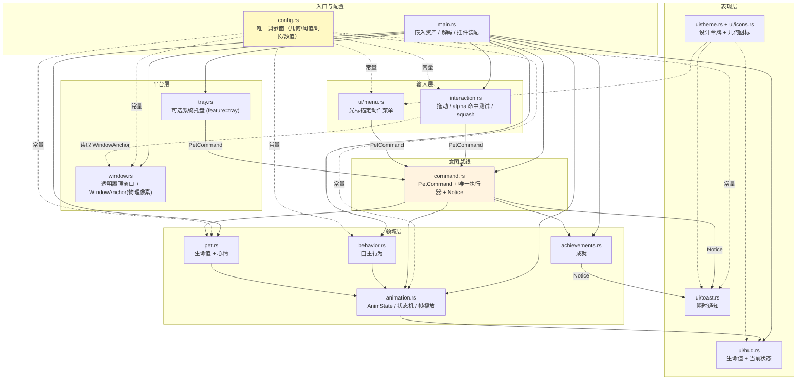
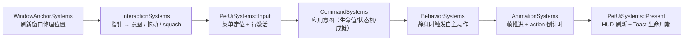
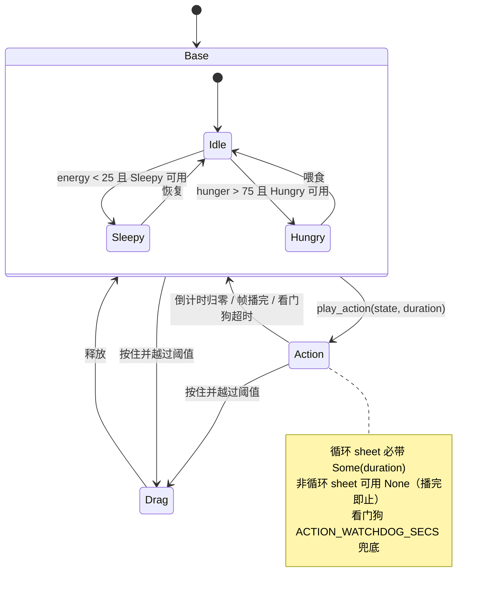
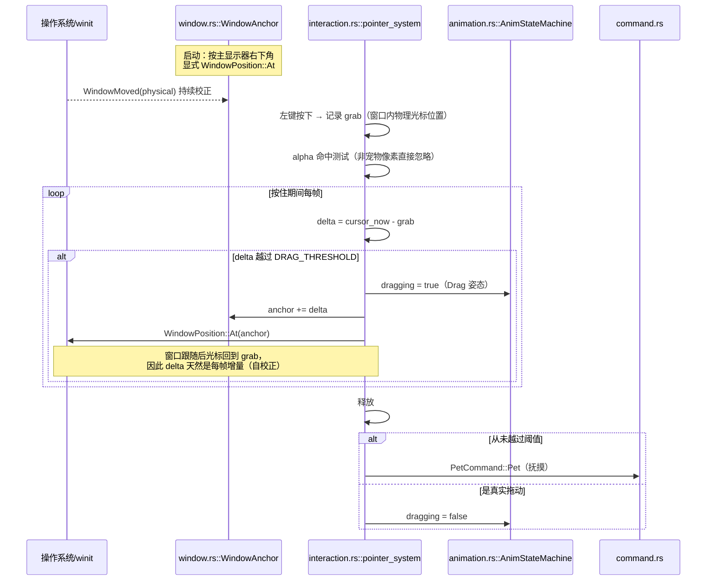

# 架构设计文档

> desktop-pet-gen — AI 驱动的桌面宠物生成器（Python 管线 + Rust/Bevy 运行时）

## 目录

- [项目构成](#项目构成)
- [核心管线流程](#核心管线流程)
- [生成器模块依赖](#生成器模块依赖)
- [数据流](#数据流)
- [Provider 体系](#provider-体系)
- [运行时架构](#运行时架构)
  - [模块分层](#模块分层)
  - [帧内系统流水线](#帧内系统流水线)
  - [动画状态机](#动画状态机)
  - [指针交互与窗口拖动](#指针交互与窗口拖动)
  - [Overlay UI](#overlay-ui)
- [生成器 ↔ 运行时契约](#生成器--运行时契约)
- [设计原则](#设计原则)
- [错误处理策略](#错误处理策略)
- [扩展点索引](#扩展点索引)

---

## 项目构成

**两个可交付物**：Python 侧交付「生成能力」，Rust 侧交付「运行时体验」。二者唯一的强耦合是
[生成器 ↔ 运行时契约](#生成器--运行时契约)（两个常量声明 + manifest 格式），其余全部通过数据驱动解耦。

---

## 核心管线流程

**控制流开关**

| 开关 | 效果 |
|------|------|
| `--body-type` | Stage 0 跳过 AI 调用，直接构造 `ClassificationResult` |
| `--skip-video` | 跳过 Stage 3/4，用 `[标准图, 尾帧]` 作 2 帧 fallback |
| `--no-compile` | Stage 7 只生成 Rust 项目目录，不执行 `cargo build` |
| 断点续跑 | 各阶段命中已有产物即跳过（日志显示「缓存命中」），不重复调用 AI API |

---

## 生成器模块依赖

**依赖方向原则**：上层依赖下层，同层不互相依赖。`pipeline.py` 通过延迟导入解耦各 Stage，
使单个阶段可以独立测试。

---

## 数据流

```mermaid
flowchart LR
    A["输入图片<br/>Path"] --> B["Stage 0"]
    B -->|"ClassificationResult<br/>{body_type, confidence, material, style}"| C["Stage 1"]
    C -->|"标准化 PNG<br/>Path"| D["Stage 2"]
    D -->|"dict[action, Path]<br/>尾帧集"| E["Stage 3"]
    E -->|"dict[action, Path]<br/>MP4 集"| F["Stage 4"]
    F -->|"dict[action, list[Path]]<br/>帧序列"| G["Stage 5"]
    G -->|"dict[action, list[Path]]<br/>透明帧序列"| H["Stage 6"]
    H -->|"manifest.json + sheets"| I["Stage 7"]
    I -->|"Rust 项目 / 二进制"| J["产物"]

    style A fill:#e1f5fe
    style J fill:#e8f5e9
```

产物目录按阶段编号落盘（`00_classification/` … `06_sprites/`），任何阶段都能单独复查与续跑。

---

## Provider 体系

Provider 通过名称注册表 + 延迟导入选择实现，新增 Provider 见
[standards/EXTEND_MECHANISMS.md](standards/EXTEND_MECHANISMS.md)。

---

## 运行时架构

### 模块分层

**关键解耦点**：任何输入面（精灵点击、右键菜单、系统托盘、未来的快捷键/IPC）都**只发
`PetCommand` 消息**，由 `command.rs` 的唯一执行器落实效果。新增输入面无需了解生命值与状态机；
新增规则只改一处。

### 帧内系统流水线

`main.rs` 用 `configure_sets(Update, (...).chain())` 显式固化每帧顺序，避免隐式调度歧义：

### 动画状态机

三层覆盖模型，渲染优先级 `drag > action > base`：

| 机制 | 作用 |
|------|------|
| 可用性感知（`AnimationAssets.available`） | mood→base、菜单项、自主行为候选全部与「实际解码成功的状态集」取交集，运行时永不硬编码 body_type |
| action 时长（`tick_action_duration`） | 循环动画倒计时回落，非循环动画播完回落，另有看门狗防止损坏 sheet 卡死 |
| 静息判定（`behavior::is_resting`） | 判据是「无 action 且未拖动」，**不要求 base == Idle**，因此 Sleepy/Hungry 心情下自主行为依旧工作 |
| 拖动冻结 | 只有当宠物确实拥有 `Drag` sheet 时才冻结帧推进，否则继续播放回落动画 |

### 指针交互与窗口拖动

窗口位置写入 `Window::position`（`WindowPosition::At`，**物理像素**），因此拖动全程只用物理像素：

设计要点：

- **不使用 `MouseMotion`**：macOS 上它是逻辑点、Windows 上是原始设备增量，与物理像素窗口位置混用必然漂移。
- **只有按在宠物身上才可拖动**：透明边缘的按下被忽略，不会「拖到空气」。
- **UI 优先**：`ui::UiBlocker` 标记的区域（菜单、HUD）吞掉指针事件，菜单点击永不穿透到宠物。
- **菜单外点击关闭菜单**，且该次点击被消费（不会顺带抚摸）。

### Overlay UI

| 表面 | 位置 | 说明 |
|------|------|------|
| 动作菜单 | 右键光标处，夹取进窗口 | 数据驱动：护理项（Feed/Play）+ 每个可用动画一行 + Sleep（有 sheet 时）+ Quit；上限 `MAX_MENU_ITEMS` |
| 状态 HUD | 左下 | `NRG / HAP / HGR` + 当前生效状态名（便于验证状态机） |
| Toast | 顶部居中 | 动作反馈与成就解锁，最多 3 条，末段淡出 |

**ASCII-only 硬约束**：Bevy 内嵌默认字体 `FiraMono-subset.ttf` 的 cmap 只有 95 个码位
（`U+0020..U+007E`），任何 emoji / `✕` / `•` / CJK 都会渲染成方块。因此 UI 文案一律 ASCII，
图标由 `ui/icons.rs` 用 UI 节点（矩形/圆/旋转条，`UiTransform` 支持旋转）组合绘制，
零字体依赖、零外部资产。完整规则见 [standards/RUNTIME_UX.md](standards/RUNTIME_UX.md)。

---

## 生成器 ↔ 运行时契约

权威定义见 **[standards/GENERATOR_RUNTIME_CONTRACT.md](standards/GENERATOR_RUNTIME_CONTRACT.md)**（单一事实源）。
要点：

- 模板 `main.rs` 中两处 `// GENERATOR-CONTRACT:` 锁定声明（`SPRITE_SHEETS` 5 元组、`FRAME_SIZE`）
  由生成器正则 patch，断言 `count == 1`；
- `AnimState` 白名单 29 变体，生成前 fail-fast；
- manifest 字段与 `frame_count` 自检；
- 除这两处常量外，模板可以自由重构 —— `tests/test_runtime_gen_contract.py::test_generate_from_real_template`
  会用真实模板端到端生成一次，守护「模板目录结构 + patch 正则」始终一致。

---

## 设计原则

| 原则 | 实现方式 |
|------|---------|
| **模块化解耦** | Python：Stage 独立文件 + 延迟导入；Rust：一职责一模块 + 插件装配 + 消息总线 |
| **数据驱动** | 动画集/时长/菜单项全部来自 manifest 与 `available` 集，运行时不硬编码 body_type |
| **Provider 抽象** | 3 套抽象基类 + 名称注册表，AI 服务可切换 |
| **配置聚合** | Python `Settings` 单一事实源；Rust `config.rs` 单一调参面 |
| **容错降级** | `GenerationResult` 不抛异常；解码失败回落 Idle/fallback 图；状态机看门狗 |
| **零文件写入** | 运行时不写盘，资产 `include_bytes!` 编译期内嵌，状态纯内存 |
| **可观测** | 管线阶段化落盘 + 缓存命中日志；运行时 HUD 显示当前状态、Toast 显示反馈 |

---

## 错误处理策略

| 场景 | 策略 | 位置 |
|------|------|------|
| AI 服务调用失败 | `GenerationResult(success=False, error=...)`，不抛异常 | `providers/base.py` |
| 分类器低置信度 | 低于 `confidence_threshold` 用默认体型 | `stages/classifier.py` |
| 异步任务超时 | `task_timeout` / `poll_interval` 控制轮询 | `config/settings.py` |
| 跳过视频 | 2 帧 fallback 保证管线跑通 | `pipeline.py` |
| 非法 AnimState | 生成前白名单 fail-fast | `runtime_gen/rust_project.py` |
| 找不到标准图 | 保留模板 fallback.png 并 warning | `runtime_gen/rust_project.py` |
| Rust 编译失败 | `RuntimeError` 携带 cargo stderr | `runtime_gen/compiler.py` |
| sheet 解码失败 | `warn` 跳过该动画；无 Idle 时用 fallback 图 | `main.rs::load_animations` |
| 缺失动画状态 | `animate_sprite` 回落 Idle | `animation.rs` |
| action 永不结束 | `ACTION_WATCHDOG_SECS` 强制清除 | `animation.rs` |
| 窗口位置未知 | 拖动跳过移动但不 panic（`WindowAnchor::offset` 返回 `Option`） | `window.rs` / `interaction.rs` |

---

## 扩展点索引

| 我要… | 看这里 |
|-------|--------|
| 新增一个动作 | [standards/EXTEND_ACTIONS.md](standards/EXTEND_ACTIONS.md) |
| 新增体型 / Provider / 管线阶段 / 运行时系统 | [standards/EXTEND_MECHANISMS.md](standards/EXTEND_MECHANISMS.md) |
| 改提示词 | [standards/EXTEND_PROMPTS.md](standards/EXTEND_PROMPTS.md) |
| 改 UI / 交互 | [standards/RUNTIME_UX.md](standards/RUNTIME_UX.md) |
| 改跨语言常量 | [standards/GENERATOR_RUNTIME_CONTRACT.md](standards/GENERATOR_RUNTIME_CONTRACT.md) |
| 提交前要跑什么 | [standards/CODE_QUALITY_GATES.md](standards/CODE_QUALITY_GATES.md) |
