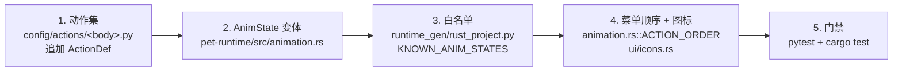

# 扩展动作规范

> 目标：新增一个动画（例如给四足体型加 `spin`），从生成管线一路贯通到运行时菜单。
> 动作是**数据**，不是代码分支 —— 下面每一步都是往注册表里加数据，不需要写 `if body_type == ...`。

## 一、五步清单



### 1. 追加 `ActionDef`

`pet_generator/config/actions/<body_type>.py`：

```python
ActionDef(
    name="spin",  # snake_case，动作集内唯一
    description="原地旋转",  # 中文描述，CLI/文档展示
    pose_prompt="... rotated 180 degrees ...",  # 尾帧（静态姿势）
    video_prompt="... spinning smoothly ...",  # 视频（运动过程）
    duration_secs=2.0,
    fps=12,
    loop=True,  # 循环动画必须能被定时回落
)
```

- `rust_variant` 自动由 `name` 推导（`spin` → `Spin`，`tail_wag` → `TailWag`）。
  只有当推导结果与目标枚举名不一致时才显式传 `rust_variant`。
- 提示词写法见 [EXTEND_PROMPTS.md](EXTEND_PROMPTS.md)。
- `loop` 语义直接影响运行时：`true` → 由 `duration_secs` 倒计时回落；
  `false` → 播完即止（`duration_secs` 仅作参考）。

### 2. 加 `AnimState` 变体

`pet-runtime/src/animation.rs`：在对应体型分组下加变体，并在 `label()` 里给一个**ASCII 标签**
（长度建议 ≤10 字符，否则菜单行会挤）。

如果它是「静息姿态」（像 `Sleepy`/`Hungry` 那样由心情驱动），还要加进 `is_mood_base()`。

### 3. 同步白名单

`pet_generator/runtime_gen/rust_project.py` 的 `KNOWN_ANIM_STATES` 必须包含新变体名，
否则生成阶段 fail-fast（这是故意的：宁可生成前报错，也不要 Rust 编译期报错）。
`snake_to_pascal` 推导不出目标名时，同时在 `ANIM_STATE_MAP` 里加显式映射。

契约要求见 [GENERATOR_RUNTIME_CONTRACT.md](GENERATOR_RUNTIME_CONTRACT.md) §3。

### 4. 让用户能主动触发它

- `animation.rs::ACTION_ORDER`：加入新变体（顺序即菜单顺序）。不加则只能靠随机行为触发。
- `ui/icons.rs::IconKind::for_state`：映射到一个语义合适的图标；必要时新增 `IconKind`
  （规则见 [RUNTIME_UX.md](RUNTIME_UX.md) 第一节）。
- 注意菜单行数上限 `MAX_MENU_ITEMS`：`ACTION_ORDER` 里靠后的项在动画特别多时会被裁掉。
  希望某个动作优先出现就把它放前面。

### 5. 跑门禁

```bash
cd desktop-pet-gen && pytest -q
cd pet-runtime && cargo fmt --check && cargo clippy --all-targets -- -D warnings && cargo test
```

`test_all_body_type_variants_known` 会遍历 4 套动作集断言每个 `rust_variant` ∈ 白名单；
`action_order_contains_no_bases_and_no_duplicates` 会守护 `ACTION_ORDER` 的一致性。

## 二、生成新动画的资产

已注册的动作会在下一次管线运行时自动生成资产：

```bash
# 只生成新动作（省钱：其余动作命中缓存）
python -u -m pet_generator -i photo.jpg -n my-pet --actions spin
```

若只改了 runtime（不需要重新生成资产），直接在生成项目里 `cargo build --release`，
或用生成器重生成项目后覆盖 `src/` 与 `Cargo.toml`（保留 `target/` 可显著加快重编）。

## 三、常见错误

| 症状 | 原因 |
|------|------|
| 生成阶段报 `Unknown AnimState variant` | 漏了第 3 步白名单 |
| Rust 编译报未知变体 | 漏了第 2 步枚举变体 |
| 动画能随机播放但菜单里没有 | 漏了第 4 步 `ACTION_ORDER` |
| 菜单里有但图标是通用圆点 | `IconKind::for_state` 未映射（可接受，但建议补） |
| 动画一直播不停 | `loop=True` 且 manifest 无 `duration_secs`；运行时会用 `LOOP_ACTION_SECS` 兜底，但应在动作定义里给准确时长 |
| 菜单被裁切 / 行挤在一起 | 行数或字号超了：见 `estimated_size` 单测与 `WINDOW_SIZE` |
