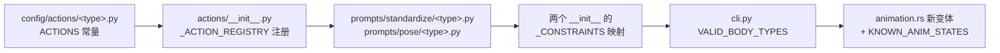

# 扩展机制规范

> 覆盖四类「加能力」的场景：新增体型、新增 Provider、新增管线阶段、新增运行时系统/输入面。
> 共同原则：**面向注册表和消息编程，不要加分支**。

## 一、新增体型（body_type）



1. `pet_generator/config/actions/<type>.py` 定义 `<TYPE>_ACTIONS: list[ActionDef]`。
2. 在 `config/actions/__init__.py` 的 `_ACTION_REGISTRY` 注册，并加进 `__all__`。
3. `prompts/standardize/<type>.py` 与 `prompts/pose/<type>.py` 各定义约束模板
   （`POSE_CONSTRAINTS` 需含 `{action_pose_prompt}` 占位）。
4. 在 `prompts/standardize/__init__.py`、`prompts/pose/__init__.py` 的 `_*_CONSTRAINTS` 字典注册。
5. `cli.py` 的 `VALID_BODY_TYPES` 加入新名字；分类器提示词（`prompts/classify.py` 的
   `BODY_TYPES`）也要能产出该分类，否则只能靠 `--body-type` 手动指定。
6. 该体型引入的新动作按 [EXTEND_ACTIONS.md](EXTEND_ACTIONS.md) 处理（枚举变体 + 白名单）。
7. 门禁：`test_all_body_type_variants_known` 会自动覆盖新体型
   （它遍历 `get_all_body_types()`），断言所有 variant 已注册。

**运行时不需要任何改动**：mood→base、菜单、自主行为都对 `available` 集取交集，
新体型只要 sheet 能解码就能工作。

## 二、新增 Provider

1. 在 `providers/image_gen/` 或 `providers/video_gen/`（或 `vision/`）新建实现文件。
2. 继承对应抽象基类，实现全部抽象方法，**返回 `GenerationResult` 而不是抛异常**：

```python
class MyImageProvider(ImageGenProvider):
    def __init__(self, settings: ProviderSettings) -> None: ...
    def generate(self, prompt, output_dir, *, size=None, quality=None, n=1) -> GenerationResult: ...
    def edit(
        self, image_paths, prompt, output_dir, *, size=None, quality=None
    ) -> GenerationResult: ...
    @property
    def supports_edit(self) -> bool:
        return True
```

3. 在 `providers/__init__.py` 的注册表加映射（**字符串路径，延迟导入**，避免可选依赖在
   未使用时也被 import）：

```python
_IMAGE_PROVIDERS["my_provider"] = "pet_generator.providers.image_gen.my_module.MyImageProvider"
```

4. `cli.py` 的 `choices` 加名字；需要新凭据/参数时扩展 `ProviderSettings`
   （字段 + `*_env` 环境变量约定，见 [../CONFIGURATION.md](../CONFIGURATION.md)）。
5. 能力差异用 `supports_*` 属性表达，让调用方降级而不是崩溃
   （例：`supports_last_frame == False` 时视频阶段只用首帧）。

## 三、新增管线阶段

1. `stages/<name>.py` 实现一个类，构造参数取 `Settings`（或它的子配置），
   对外只暴露一个动词方法（如 `run` / `pack_all`），输入输出都用 `Path` / `dict[str, ...]`。
2. 在 `stages/__init__.py` 导出。
3. 在 `pipeline.py` 里编排：**延迟导入**、独立的编号输出目录（`0N_<name>/`）、
   命中已有产物即跳过（断点续跑），并打印缓存命中日志。
4. 阶段内部的并发范式参考 `stages/video_generator.py` / `pose_generator.py`
   （`ThreadPoolExecutor` + `as_completed`，主线程串行收集，单项失败 warn+skip 不阻塞整体）。
5. 写产物时先落临时名再原子重命名，避免中断留下半成品被后续误判为缓存命中。
6. 加一个不触网的单测（用 fixture / 假 Provider）。

## 四、新增运行时系统 / 输入面（Rust）

### 4.1 新输入面：只发消息

```rust
// 例：键盘快捷键
fn hotkeys(keys: Res<ButtonInput<KeyCode>>, mut commands: MessageWriter<PetCommand>) {
    if keys.just_pressed(KeyCode::KeyF) {
        commands.write(PetCommand::Feed);
    }
}
```

注册到 `CommandSystems` 之前的集合（`InteractionSystems` 或 `PetUiSystems::Input`），
意图即可在同一帧被 `apply_commands` 落实。**不要**在输入面里直接改 `Pet` 或 `AnimStateMachine`。

### 4.2 新规则：改一处

新增/调整效果（喂食恢复多少、某动作播多久）只改两个地方：
`config.rs`（数值）与 `command.rs::resolve`（语义），并补一个 `resolve` 的单测。
`resolve` 是纯函数，测试不需要 `App`。

### 4.3 新功能模块：一职责一插件

```rust
// src/my_feature.rs
pub struct MyFeaturePlugin;
impl Plugin for MyFeaturePlugin {
    fn build(&self, app: &mut App) {
        app.init_resource::<MyState>()
           .add_systems(Update, my_system.in_set(/* 已有集合，或新集合 */));
    }
}
```

- 在 `main.rs` 的 `add_plugins((...))` 里加一行；
- 若需要新的帧内位置，在 `main.rs` 的 `configure_sets(Update, (...).chain())` 里插入新集合
  —— 帧内顺序集中在这一处声明，不要用零散的 `.before/.after` 制造隐式依赖网。
- 需要给用户可见反馈就发 `Notice`，不要自己画 UI。

### 4.4 新 UI 表面

在 `ui/` 下建模块 + `Plugin`，在 `ui/mod.rs::PetUiPlugin` 里加进 `add_plugins`。
样式一律取 `ui/theme.rs` 的令牌；交互式根节点挂 `UiBlocker`；文案 ASCII-only。
详见 [RUNTIME_UX.md](RUNTIME_UX.md)。

### 4.5 新可选特性（feature）

参考 `tray.rs`：`Cargo.toml` 里 `optional = true` + `[features]` 映射，代码里
`#[cfg(feature = "…")]` 真实实现 + `#[cfg(not(...))]` 空实现（打印一行说明）。
默认构建必须不依赖它，并且 `cargo check --features <name>` 也要加进 CI 检查。

## 五、跨语言改动

任何触及以下内容的改动，**先改 [GENERATOR_RUNTIME_CONTRACT.md](GENERATOR_RUNTIME_CONTRACT.md)，再改代码**：

- `SPRITE_SHEETS` 元组形状或其锁定注释；
- `FRAME_SIZE` 声明；
- manifest 字段；
- `AnimState` 白名单。

模板 `src/` 的**其他**部分可以自由重构（新增/删除/移动模块都可以）：生成器整目录复制，
`test_generate_from_real_template` 会守护「真实模板 + patch 正则 + 目录结构」始终一致。
