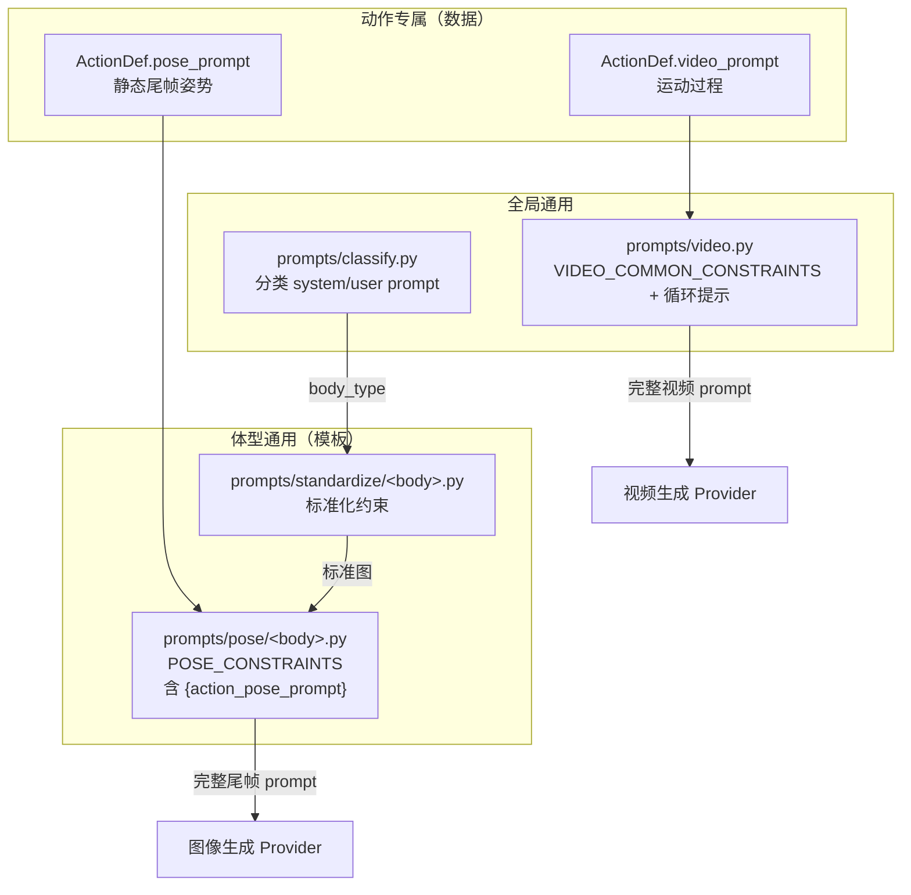

# 扩展提示词规范

> 提示词分四类，各有唯一入口。改提示词前先确认「该改哪一层」——
> 动作专属描述放动作定义里，体型通用约束放 prompts 模板里，二者不要互相渗透。

## 一、四类提示词与归属



| 类别 | 入口函数 | 文件 | 何时改 |
|------|---------|------|-------|
| 分类 | `build_classify_user_prompt` | `prompts/classify.py` | 体型识别不准、要加新分类维度 |
| 标准化 | `get_standardize_prompt(body_type, ...)` | `prompts/standardize/` | 标准图构图/风格/背景不符预期 |
| 尾帧 | `get_pose_prompt(body_type, action_pose_prompt)` | `prompts/pose/` | 姿态偏离、角色一致性差 |
| 视频 | `get_video_prompt(action_video_prompt, loop)` | `prompts/video.py` | 运动不自然、循环接不上、有镜头运动 |

## 二、分层规则（重要）

1. **动作专属只描述"这个动作"**：`pose_prompt` 只写姿势，`video_prompt` 只写运动。
   不要在动作里重复写「白背景 / 不要镜头运动 / 保持角色一致」——那是通用约束的职责，
   重复会稀释权重并制造互相冲突的表述。
2. **体型通用只描述"这类身体"**：四肢关系、朝向、支撑点、可动范围。
   不要把某个动作的细节塞进体型模板，否则所有动作都会被污染。
3. **全局通用只描述"所有视频/所有图"**：背景、镜头、一致性、循环性。
4. `POSE_CONSTRAINTS` 必须保留 `{action_pose_prompt}` 占位符，`get_pose_prompt` 用
   `str.format` 注入；新增体型模板忘了占位符会静默丢掉动作描述。

## 三、写法约定

- **英文撰写**：模型对英文提示词更稳定；中文只出现在 `description` 与文档里。
- **结构化优先**：用分段标题（如 `MOTION DESCRIPTION:` / `GENERAL VIDEO CONSTRAINTS:` /
  `LOOP HANDLING:`）而不是一长串逗号，便于模型分辨约束层级，也便于人读 diff。
- **正向表述优先**：`clean white background` 好于 `no messy background`；
  必须用否定时集中放在通用约束里。
- **可复现**：不要引入随机词、时间戳、无意义修饰。
- **循环语义**：循环动作强调首尾帧衔接，一次性动作强调「起止于自然静止姿态」——
  这已在 `get_video_prompt(loop=…)` 里实现，动作里不必重复。

## 四、调优流程

```bash
# 1. 只跑受影响的动作，观察产物（命中缓存的动作不会重复扣费）
python -u -m pet_generator -i photo.jpg -n tune --actions spin --no-compile

# 2. 逐阶段查看落盘产物
#    01_standard/  标准化是否达标
#    02_poses/     尾帧姿势是否正确
#    03_videos/    运动与循环是否自然
#    05_nobg/      抠图边缘是否干净

# 3. 不满意就重跑该动作：删掉对应阶段产物再执行同一命令
rm 02_poses/spin.png 03_videos/spin.mp4
```

调优顺序固定为 **分类 → 标准化 → 尾帧 → 视频**：上游不达标时改下游是浪费，
标准图不对，后面每个动作都会错。

## 五、评审要点

| 检查项 | 理由 |
|--------|------|
| 是否放在了正确的层 | 防止约束扩散与相互冲突 |
| 是否与通用约束重复/冲突 | 重复会稀释权重，冲突会让输出抖动 |
| 是否保留 `{action_pose_prompt}` | 缺失会静默丢动作描述 |
| 是否影响既有动作 | 改通用模板等于改全部动作，需要抽样复跑 |
| 是否记录了调优结论 | 有效结论上收到本文档或任务文档，避免重复试错 |
